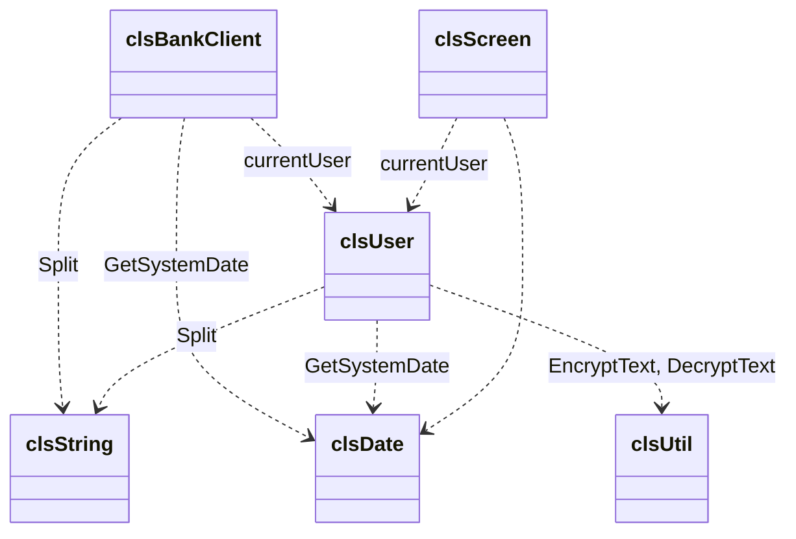
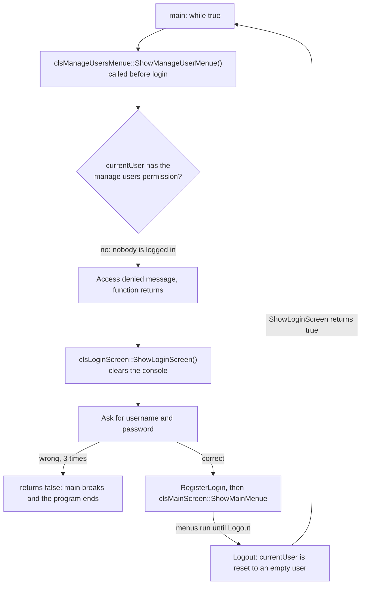
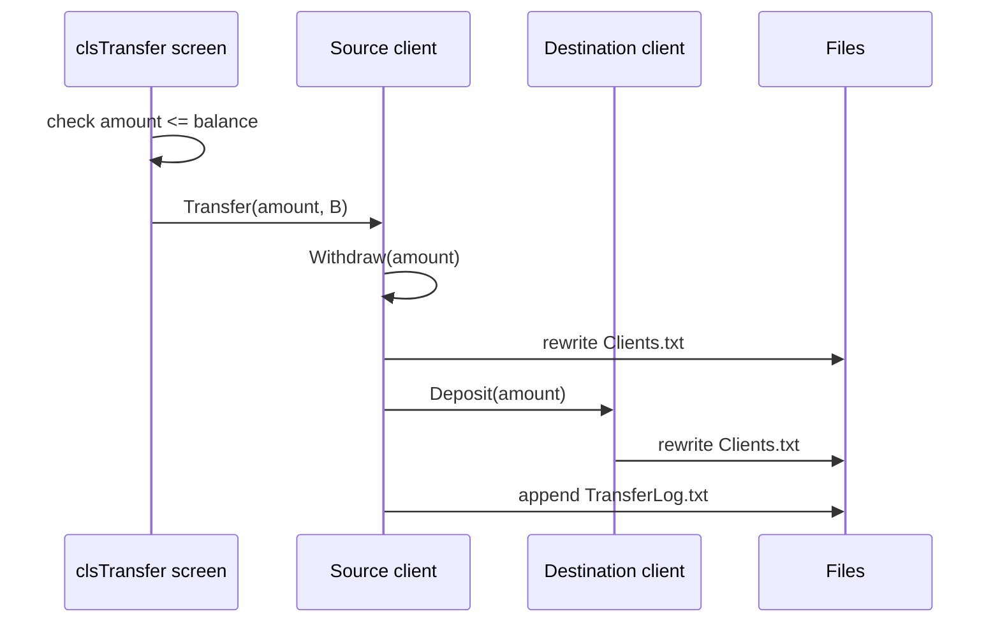

# Architecture

This describes the program as it is, including the weak points.

## Overview

The code has three parts. Most of it is in header files, including full function bodies. `BankSystembyOOP.cpp` is the only `.cpp` file and it only contains `main`.

1. **Screens** ask for input and print the output.
2. **Entities** (`clsPerson`, `clsBankClient`, `clsUser`) hold the data and read and write their own text file.
3. **Helpers** (`clsDate`, `clsString`, `clsUtil`, `clsInputValidate`, `clsPeriod`) are small tools used everywhere.

There is no separate data layer. Each entity class opens its file directly.

## Files

| Group | Files |
|---|---|
| Entry point | `BankSystembyOOP.cpp` (only `main`) |
| Global | `Global.h` (holds `currentUser`, the logged-in user) |
| Entities | `clsPerson.h`, `clsBankClient.h`, `clsUser.h` |
| Screen base class | `clsScreen.h` |
| Login and main menu | `clsLoginScreen.h`, `clsMainScreen.h` |
| Client screens | `clsClientListScreen.h`, `clsAddNewClientScreen.h`, `clsDeletClientScreen .h`, `clsUpdateClientScreen.h`, `clsFindClientScreen.h` |
| Transaction screens | `clsTransactionsScreen.h`, `clsDepositScreen.h`, `clsWithDrawScreen.h`, `clsTotalBalancesScreen.h`, `clsTransfer.h`, `clsTransferLog.h` |
| User screens | `clsManageUsersMenue.h`, `clsUsersListScreen.h`, `clsAddNewUserScreen.h`, `clsDeleteUserScreen.h`, `clsUpdateUserScreen.h`, `clsFindUserScreen.h` |
| Login register | `clsLoginRegister.h` |
| Helpers | `clsDate.h`, `clsString.h`, `clsUtil.h`, `clsInputValidate.h`, `clsPeriod.h` |
| Data files | `Clients.txt`, `Users.txt`, `LoginRegister.txt`, `TransferLog.txt` (fictional test data, in the project folder) |

The file `clsDeletClientScreen .h` has a space in its name and "Delet" is misspelled. I left the original names as they are.

## Classes

These are the real classes in the project. The first diagram shows inheritance. `clsPerson` is the base class of the two entities, and `clsScreen` is the base class of all 20 screen classes.

```mermaid
classDiagram
    clsPerson <|-- clsBankClient : public
    clsPerson <|-- clsUser : public
    clsScreen <|-- clsLoginScreen : protected
    clsScreen <|-- clsMainScreen : protected
    clsScreen <|-- clsClientListScreen : protected
    clsScreen <|-- clsAddNewClientScreen : protected
    clsScreen <|-- clsDeletClientScreen : protected
    clsScreen <|-- clsUpdateClientScreen : protected
    clsScreen <|-- clsFindClientScreen : protected
    clsScreen <|-- TransactionsScreen : protected
    clsScreen <|-- clsDepositScreen : protected
    clsScreen <|-- clsWithDrawScreen : protected
    clsScreen <|-- clsTotalBalancesScreen : protected
    clsScreen <|-- clsTransfer : protected
    clsScreen <|-- clsTransferLog : protected
    clsScreen <|-- clsManageUsersMenue : protected
    clsScreen <|-- clsUsersListScreen : protected
    clsScreen <|-- clsAddNewUserScreen : protected
    clsScreen <|-- clsDeleteUserScreen : protected
    clsScreen <|-- clsUpdateUserScreen : protected
    clsScreen <|-- clsFindUserScreen : protected
    clsScreen <|-- clsLoginRegister : protected
```

The second diagram shows which helper classes the entities and `clsScreen` call. I checked each arrow in the source. `currentUser` is the global object from `Global.h`.

`clsBankClient` does not call `clsUtil`. That is why client PINs are saved as plain text.

## Program flow

`main` is a loop. This is the real order of calls in `BankSystembyOOP.cpp`:

The call to `ShowManageUserMenue()` before the login screen does nothing useful. At that point `currentUser` is empty, so the permission check fails and only an access denied message is printed. The login screen then clears the console.

Every screen first checks `currentUser.CheckAccessPermissions(...)`. When an action is finished, a menu calls its own `Show...` function again instead of using a loop. This means the call stack gets deeper with every action until the user logs out.

## Permissions

Each user has one integer. Each permission is one bit:

| Value | Permission |
|---|---|
| 1 | List clients |
| 2 | Add client |
| 4 | Delete client |
| 8 | Update client |
| 16 | Find client |
| 32 | Transactions |
| 64 | Manage users |
| 128 | Login register |
| -1 | Everything |

The check is `(required & user.Permissions) == required`.

## Data files

The program opens these files by name from its working directory. The project does not set one, so Visual Studio uses the project folder, where the four files are. Fields are separated by `#//#`.

| File | Fields |
|---|---|
| `Clients.txt` | FirstName, LastName, Email, Phone, AccountNumber, PinCode, Balance |
| `Users.txt` | FirstName, LastName, Email, Phone, UserName, Password, Permissions |
| `LoginRegister.txt` | Date, UserName, Password, Permissions |
| `TransferLog.txt` | Date, FromAccount, ToAccount, Amount, BalanceFrom, BalanceTo, User |

- **Read:** open the file, read line by line, split each line on `#//#` and build the objects.
- **Update or delete:** load all records into a `vector`, change one record and write the whole file again.
- **Add a record or a log line:** append one line to the end of the file.

## Transfer

`Transfer` does not check the result of `Withdraw`, and nothing checks for negative amounts. Details are in [SECURITY_LIMITATIONS.md](SECURITY_LIMITATIONS.md).

## Design notes

- The entity classes save themselves. This is simple, but it ties the data to the files.
- Most code is in header files, and many of them use `using namespace std;`.
- It only builds with the Microsoft compiler.
